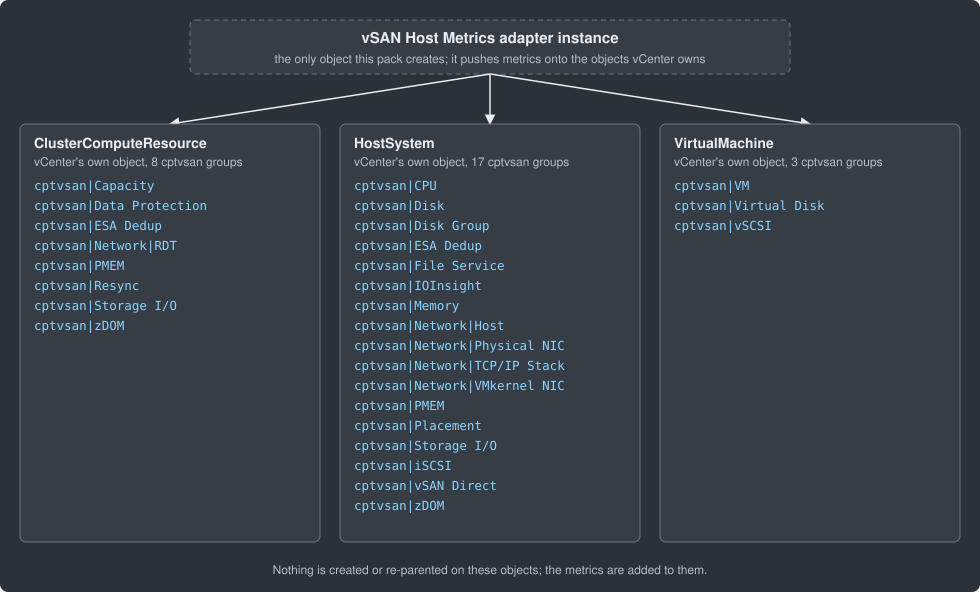

# vSAN Host Metrics Documentation

> Generated index. The inventory page and diagram are rewritten after every
> build by tools/fix_generated_docs.py; prose sections (overview, installing) are hand-curated.

## Contents

| Section | Description |
|---------|-------------|
| [Overview](overview.md) | What's in the pack, resource kinds, cross-adapter notes |
| [Installing & Configuring](installing.md) | Prerequisites, configuration fields, step-by-step guide |
| [Where the data lives](inventory-tree.md) | Which vCenter objects carry the `cptvsan` metrics, and which groups |
| [Metrics Reference](../REFERENCE.md) | Full metrics and properties reference (generated) |

## Where the data lives

## Quick Reference

- **Adapter kind:** `vsanhostmetrics`
- **Version:** 3.0.1.1
- **Objects created:** this pack creates no objects of its own except its adapter instance: it pushes `cptvsan|...` metrics onto vCenter's own cluster, host and virtual machine objects (see [Where the data lives](inventory-tree.md)).
