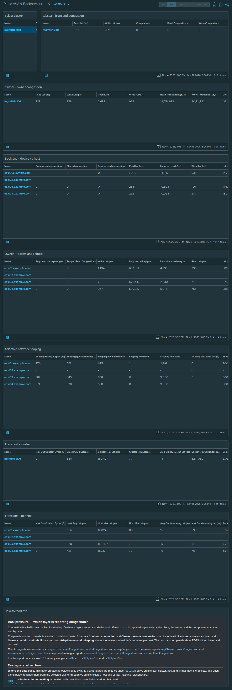

# Rapid vSAN Backpressure

## Widgets

- **Select cluster**: lists the clusters; the selected cluster drives every other widget.
- **Cluster - front end congestion**: the *vSAN Cluster DOM Client* view, one row per cluster; 11 columns, including Read Lat (μs), Write Lat (μs), Congestions, Read Congestions, and more.
- **Cluster - owner congestion**: the *vSAN Cluster DOM Owner* view, one row per cluster; 10 columns, including Read Lat (μs), Write Lat (μs), Read IOPS, Write IOPS, and more.
- **Back end - device vs host**: the *vSAN Host DOM Component Manager* view, one row per host; 16 columns, including Component congestion, Shared congestion, Resync read congestion, Read Lat (μs), and more.
- **Owner - reclaim and rebuild**: the *vSAN Host DOM Owner* view, one row per host; 16 columns, including Seg clean unmap congestion, Resync Read Congestions, Write Lat (μs), Lat (max, write) (μs), and more.
- **Adaptive network shaping**: the *vSAN Host DOM Owner Scheduler* view, one row per host; 12 columns, including Shaping rolling avg lat (μs), Shaping guest lt latency (μs), Shaping low band thresh (μs), Shaping low band, and more.
- **Transport - cluster**: the *vSAN Cluster RDT* view, one row per cluster; 9 columns, including Max Out Context Bytes (B), Cluster Avg Lat (μs), Cluster Max Lat (μs), Cluster Min Lat (μs), and more.
- **Transport - per host**: the *vSAN RDT Transport Per Host* view, one row per host; 11 columns, including Max Out Context Bytes (B), Host Avg Lat (μs), Host Max Lat (μs), Host Min Lat (μs), and more.
- **How to read this**: the help text box, reproduced below.

## Help text

The text box on the dashboard reads as follows.

### Backpressure — which layer is reporting congestion?

Congestion is vSAN's mechanism for slowing IO when a layer cannot absorb the load offered to it. It is reported separately by the client, the owner and the component manager, and by type.

The panels run from the whole cluster to individual hosts. **Cluster - front end congestion** and **Cluster - owner congestion** are cluster level. **Back end - device vs host** and **Owner - reclaim and rebuild** are per host. **Adaptive network shaping** shows the network scheduler's counters per host. The two transport panels show RDT for the cluster and per host.

Client congestion is reported as `congestion`, `readCongestion`, `writeCongestion` and `unmapCongestion`. The owner reports `segCleanerUnmapCongestion` and `recoveryWriteCongestion`. The component manager reports `componentCongestion`, `sharedCongestion` and `resyncReadCongestion`.

The transport panels show RDT latency alongside `kaReset`, `txSbSpaceMin` and `rxSbSpaceMin`.

#### Reading any column here

**Where the data lives.** This pack creates no objects of its own. Its vSAN figures are metrics under `cptvsan` on vCenter's own cluster, host and virtual machine objects, and each panel below reaches them from the selected cluster through vCenter's cluster, host and virtual machine relationships.

**Units are in the column heading.** A heading with no unit has no unit declared for that metric.

**A blank cell is not a zero.** A blank cell means no value was collected for that column in the selected period.

**Raw columns are cumulative counts.** Where a column has a Raw twin, the Raw column is the cumulative count and the other column is a per-interval rate.

#### Cluster - front end congestion

Renders the **vSAN Cluster DOM Client** view. Metrics under `cptvsan|Storage I/O:dom-client` on the vCenter cluster object (ClusterComputeResource).

**`Read Lat (μs)`** — Average read latency at this layer. For the client, component manager and zDOM layers the vSAN Performance Service graph definition marks 15 ms as warning and 30 ms as critical; it defines no threshold for the owner layer.

**`Write Lat (μs)`** — Average write latency at this layer. For the client, component manager and zDOM layers the vSAN Performance Service graph definition marks 15 ms as warning and 30 ms as critical; it defines no threshold for the owner layer.

**`Congestions`** — vSAN congestion raised at this layer.

**`Read Congestions`** — Backpressure attributed to reads.

**`Write Congestions`** — Backpressure attributed to writes.

**`Unmap congestion`** — Congestion attributed to unmap operations.

**`Read IOPS`** — Read operations per second.

**`Write IOPS`** — Write operations per second.

**`OIO`** — Outstanding IO: operations issued and not yet completed. Latency multiplied by nothing tells you why it is high -- this does. High latency with high outstanding IO is queueing, high latency with low outstanding IO is a slow device.

**`Read Throughput (B/s)`** — Bytes per second read at this layer.

**`Write Throughput (B/s)`** — Bytes per second written at this layer.

#### Cluster - owner congestion

Renders the **vSAN Cluster DOM Owner** view. Metrics under `cptvsan|Storage I/O:dom-owner` on the vCenter cluster object (ClusterComputeResource).

**`Read Lat (μs)`** — Average read latency at this layer. For the client, component manager and zDOM layers the vSAN Performance Service graph definition marks 15 ms as warning and 30 ms as critical; it defines no threshold for the owner layer.

**`Write Lat (μs)`** — Average write latency at this layer. For the client, component manager and zDOM layers the vSAN Performance Service graph definition marks 15 ms as warning and 30 ms as critical; it defines no threshold for the owner layer.

**`Read IOPS`** — Read operations per second.

**`Write IOPS`** — Write operations per second.

**`Read Throughput (B/s)`** — Bytes per second read. The owner layer names its throughput columns differently from the client layer; the quantity is the same.

**`Write Throughput (B/s)`** — Bytes per second written.

**`OIO`** — Outstanding IO: operations issued and not yet completed. Latency multiplied by nothing tells you why it is high -- this does. High latency with high outstanding IO is queueing, high latency with low outstanding IO is a slow device.

**`Congestions`** — vSAN congestion raised at this layer.

**`Read Congestions`** — Backpressure attributed to reads.

**`Write Congestions`** — Backpressure attributed to writes.

#### Back end - device vs host

Renders the **vSAN Host DOM Component Manager** view. Metrics under `cptvsan|Storage I/O:dom-compmgr` on the vCenter host object (HostSystem).

**`Component congestion`** — Congestion raised against a single component. Shown beside shared congestion on the same row.

**`Shared congestion`** — Shared congestion, as distinct from congestion raised against a single component.

**`Resync read congestion`** — Congestion attributed to resync reads.

**`Read Lat (μs)`** — Average read latency at this layer. For the client, component manager and zDOM layers the vSAN Performance Service graph definition marks 15 ms as warning and 30 ms as critical; it defines no threshold for the owner layer.

**`Lat (max, read) (μs)`** — Worst read latency in the interval.

**`Write Lat (μs)`** — Average write latency at this layer. For the client, component manager and zDOM layers the vSAN Performance Service graph definition marks 15 ms as warning and 30 ms as critical; it defines no threshold for the owner layer.

**`Lat (max, write) (μs)`** — Worst write latency in the interval.

**`Lat stddev (write) (μs)`** — Standard deviation of write latency.

**`Read IOPS`** — Read operations per second.

**`Write IOPS`** — Write operations per second.

**`OIO`** — Outstanding IO: operations issued and not yet completed. Latency multiplied by nothing tells you why it is high -- this does. High latency with high outstanding IO is queueing, high latency with low outstanding IO is a slow device.

**`Read Throughput (B/s)`** — Bytes per second read at this layer.

**`Write Throughput (B/s)`** — Bytes per second written at this layer.

**`VM disk queue depth (write)`** — Queue depth for virtual disk writes at the component manager.

**`VM disk dispatched cost (write) (B/s)`** — Cost of dispatched virtual disk writes, as reported by the component manager.

**`Namespace dispatched cost (write) (B/s)`** — Cost of dispatched writes to namespace objects, which hold VM configuration files, as reported by the component manager.

#### Owner - reclaim and rebuild

Renders the **vSAN Host DOM Owner** view. Metrics under `cptvsan|Storage I/O:dom-owner` on the vCenter host object (HostSystem).

**`Seg clean unmap congestion`** — Congestion attributed to segment cleaner unmap work.

**`Resync Read Congestions`** — Congestion reported under the id recoveryWriteCongestion. The Performance Service publishes it under the name "Resync Read Congestions", and the column label is that Broadcom name.

**`Write Lat (μs)`** — Average write latency at this layer. For the client, component manager and zDOM layers the vSAN Performance Service graph definition marks 15 ms as warning and 30 ms as critical; it defines no threshold for the owner layer.

**`Lat (max, write) (μs)`** — Worst write latency in the interval.

**`Lat stddev (write) (μs)`** — Standard deviation of write latency.

**`Read Lat (μs)`** — Average read latency at this layer. For the client, component manager and zDOM layers the vSAN Performance Service graph definition marks 15 ms as warning and 30 ms as critical; it defines no threshold for the owner layer.

**`Lat (max, read) (μs)`** — Worst read latency in the interval.

**`High outstanding IO duration % (write)`** — High outstanding IO duration for writes, as a percentage of the interval.

**`Owner2 pc commit latency avg (μs)`** — Average latency, in microseconds, of the owner's 2PC (two-phase commit) of a write.

**`Write leaf owner latency local (μs)`** — Write latency for replicas on this host.

**`Write leaf owner latency remote (μs)`** — Write latency for replicas on other hosts.

**`Read leaf owner latency local (μs)`** — Read latency served from this host's own disks.

**`Read leaf owner latency remote (μs)`** — Read latency served from another host's disks.

**`Server switch count`** — Cumulative count of server switches.

**`IOPS`** — Total operations per second at this layer, reads and writes together.

**`OIO`** — Outstanding IO: operations issued and not yet completed. Latency multiplied by nothing tells you why it is high -- this does. High latency with high outstanding IO is queueing, high latency with low outstanding IO is a slow device.

#### Adaptive network shaping

Renders the **vSAN Host DOM Owner Scheduler** view. Metrics under `cptvsan|Storage I/O:dom-owner` on the vCenter host object (HostSystem).

**`Shaping rolling avg lat (μs)`** — Rolling average latency, in microseconds, reported by adaptive network shaping.

**`Shaping guest lt latency (μs)`** — Guest long-tail latency, in microseconds, reported by adaptive network shaping.

**`Shaping low band thresh (μs)`** — Latency threshold, in microseconds, for the low band.

**`Shaping low band`** — Number of times this host was placed in the low band.

**`Shaping mid band`** — Number of times this host was placed in the middle band.

**`Shaping low band sec (s)`** — Seconds spent in the low band.

**`Shaping mid band sec (s)`** — Seconds spent in the middle band.

**`Shaping low to mid band`** — Transitions from the low band to the middle band.

**`Shaping mid to low band`** — Transitions from the middle band to the low band.

**`Shaping seen total tp (B/s)`** — Total throughput observed by adaptive network shaping.

**`Shaping seen non resync tp (B/s)`** — Throughput observed by adaptive network shaping, excluding resync traffic.

**`Shaping controller IOPS limit`** — Controller IOPS limit reported by adaptive network shaping.

#### Transport - cluster

Renders the **vSAN Cluster RDT** view. Metrics under `cptvsan|Network|RDT` on the vCenter cluster object (ClusterComputeResource).

**`Max Out Context Bytes (B)`** — Maximum outbound RDT context bytes over the last 5 seconds.

**`Cluster Avg Lat (μs)`** — Average round-trip latency of vSAN's own transport between hosts. This sits above TCP, so it can be slow while every NIC counter is clean.

**`Cluster Max Lat (μs)`** — Worst round-trip latency in the interval.

**`Cluster Min Lat (μs)`** — Best round-trip latency in the interval.

**`Avg Out Queueing Lat (μs)`** — Average time a message waited in the outbound queue before being sent. Queueing, as opposed to time on the wire.

**`Socket Min Out Bytes (Low Is Bad) (B)`** — Lowest free space in the outbound socket buffer in the interval.

**`Socket Min In Bytes (Low Is Bad) (B)`** — Lowest free space seen in the inbound socket buffer. **Low is bad**, for the same reason.

**`Keepalive reset (Total)`** — Cumulative count of RDT keepalive resets.

**`Num ready delay (Total)`** — Cumulative count of ready delays.

#### Transport - per host

Renders the **vSAN RDT Transport Per Host** view. Metrics under `cptvsan|Network|Host` on the vCenter host object (HostSystem).

**`Max Out Context Bytes (B)`** — Maximum outbound RDT context bytes over the last 5 seconds.

**`Host Avg Lat (μs)`** — Average round-trip latency of vSAN's own transport between hosts. This sits above TCP, so it can be slow while every NIC counter is clean.

**`Host Max Lat (μs)`** — Worst round-trip latency in the interval.

**`Host Min Lat (μs)`** — Best round-trip latency in the interval.

**`Avg Out Queueing Lat (μs)`** — Average time a message waited in the outbound queue before being sent. Queueing, as opposed to time on the wire.

**`Max Out Queueing Lat (μs)`** — Worst outbound queueing delay in the interval.

**`Socket Min Out Bytes (Low Is Bad) (B)`** — Lowest free space in the outbound socket buffer in the interval.

**`Socket Min In Bytes (Low Is Bad) (B)`** — Lowest free space seen in the inbound socket buffer. **Low is bad**, for the same reason.

**`Socket Max In Bytes (B)`** — Highest free space seen inbound. Context for the minimum beside it.

**`Keepalive reset (Total)`** — Cumulative count of RDT keepalive resets.

**`Num ready delay (Total)`** — Cumulative count of ready delays.

## Complete the install

1. Go to Administration → Integrations → **Accounts** tab → **ADD** → choose the **vSAN Host Metrics** tile.
2. Fill in **Add Account - vSAN Host Metrics**: **Name**; **vCenter Server**; **vCenter username**; **Credential** → **+** → **Credential name** and **vCenter password** → **OK**; **Verify vCenter certificate**; **Cloud Proxy / Group** (9.1.1) or **Collector / Group** (8.18). The vCenter port is under **Advanced Settings** (default 443).
3. Click **VALIDATE CONNECTION** and accept the vCenter certificate when prompted. Then click **ADD**.
4. **After installing or upgrading the pak:** Administration → Integrations → Accounts → expand **vSAN Host Metrics** → check the account's **Status**. If it isn't collecting, use ⋮ on the account row → **Start Collecting**.
5. **Requirements:** vCenter 8.0 U3 or later, or 9.0 or later; a vCenter account that can read vSAN performance data.

No policy or super-metric changes are needed.
