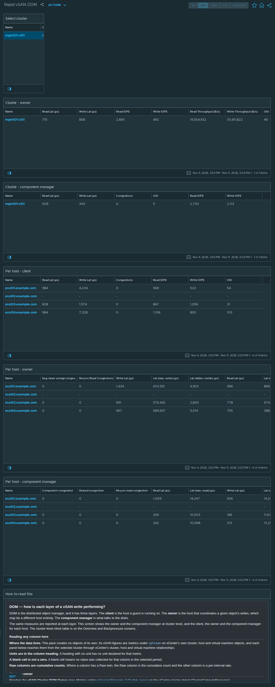

# Rapid vSAN DOM

## Widgets

- **Select cluster**: lists the clusters; the selected cluster drives every other widget.
- **Cluster - owner**: the *vSAN Cluster DOM Owner* view, one row per cluster; 10 columns, including Read Lat (μs), Write Lat (μs), Read IOPS, Write IOPS, and more.
- **Cluster - component manager**: the *vSAN Cluster DOM Component Manager* view, one row per cluster; 6 columns, including Read Lat (μs), Write Lat (μs), Congestions, OIO, and more.
- **Per host - client**: the *vSAN Host DOM* view, one row per host; 6 columns, including Read Lat (μs), Write Lat (μs), Congestions, Read IOPS, and more.
- **Per host - owner**: the *vSAN Host DOM Owner* view, one row per host; 16 columns, including Seg clean unmap congestion, Resync Read Congestions, Write Lat (μs), Lat (max, write) (μs), and more.
- **Per host - component manager**: the *vSAN Host DOM Component Manager* view, one row per host; 16 columns, including Component congestion, Shared congestion, Resync read congestion, Read Lat (μs), and more.
- **How to read this**: the help text box, reproduced below.

## Help text

The text box on the dashboard reads as follows.

### DOM — how is each layer of a vSAN write performing?

DOM is the distributed object manager, and it has three layers. The **client** is the host a guest is running on. The **owner** is the host that coordinates a given object's writes, which may be a different host entirely. The **component manager** is what talks to the disks.

The same measures are reported at each layer. This screen shows the owner and the component manager at cluster level, and the client, the owner and the component manager for each host. The cluster-level client table is on the Overview and Backpressure screens.

#### Reading any column here

**Where the data lives.** This pack creates no objects of its own. Its vSAN figures are metrics under `cptvsan` on vCenter's own cluster, host and virtual machine objects, and each panel below reaches them from the selected cluster through vCenter's cluster, host and virtual machine relationships.

**Units are in the column heading.** A heading with no unit has no unit declared for that metric.

**A blank cell is not a zero.** A blank cell means no value was collected for that column in the selected period.

**Raw columns are cumulative counts.** Where a column has a Raw twin, the Raw column is the cumulative count and the other column is a per-interval rate.

#### Cluster - owner

Renders the **vSAN Cluster DOM Owner** view. Metrics under `cptvsan|Storage I/O:dom-owner` on the vCenter cluster object (ClusterComputeResource).

**`Read Lat (μs)`** — Average read latency at this layer. For the client, component manager and zDOM layers the vSAN Performance Service graph definition marks 15 ms as warning and 30 ms as critical; it defines no threshold for the owner layer.

**`Write Lat (μs)`** — Average write latency at this layer. For the client, component manager and zDOM layers the vSAN Performance Service graph definition marks 15 ms as warning and 30 ms as critical; it defines no threshold for the owner layer.

**`Read IOPS`** — Read operations per second.

**`Write IOPS`** — Write operations per second.

**`Read Throughput (B/s)`** — Bytes per second read. The owner layer names its throughput columns differently from the client layer; the quantity is the same.

**`Write Throughput (B/s)`** — Bytes per second written.

**`OIO`** — Outstanding IO: operations issued and not yet completed. Latency multiplied by nothing tells you why it is high -- this does. High latency with high outstanding IO is queueing, high latency with low outstanding IO is a slow device.

**`Congestions`** — vSAN congestion raised at this layer.

**`Read Congestions`** — Backpressure attributed to reads.

**`Write Congestions`** — Backpressure attributed to writes.

#### Cluster - component manager

Renders the **vSAN Cluster DOM Component Manager** view. Metrics under `cptvsan|Storage I/O:dom-compmgr` on the vCenter cluster object (ClusterComputeResource).

**`Read Lat (μs)`** — Average read latency at this layer. For the client, component manager and zDOM layers the vSAN Performance Service graph definition marks 15 ms as warning and 30 ms as critical; it defines no threshold for the owner layer.

**`Write Lat (μs)`** — Average write latency at this layer. For the client, component manager and zDOM layers the vSAN Performance Service graph definition marks 15 ms as warning and 30 ms as critical; it defines no threshold for the owner layer.

**`Congestions`** — vSAN congestion raised at this layer.

**`OIO`** — Outstanding IO: operations issued and not yet completed. Latency multiplied by nothing tells you why it is high -- this does. High latency with high outstanding IO is queueing, high latency with low outstanding IO is a slow device.

**`Read IOPS`** — Read operations per second.

**`Write IOPS`** — Write operations per second.

#### Per host - client

Renders the **vSAN Host DOM** view. Metrics under `cptvsan|Storage I/O:dom-client` on the vCenter host object (HostSystem).

**`Read Lat (μs)`** — Average read latency at this layer. For the client, component manager and zDOM layers the vSAN Performance Service graph definition marks 15 ms as warning and 30 ms as critical; it defines no threshold for the owner layer.

**`Write Lat (μs)`** — Average write latency at this layer. For the client, component manager and zDOM layers the vSAN Performance Service graph definition marks 15 ms as warning and 30 ms as critical; it defines no threshold for the owner layer.

**`Congestions`** — vSAN congestion raised at this layer.

**`Read IOPS`** — Read operations per second.

**`Write IOPS`** — Write operations per second.

**`OIO`** — Outstanding IO: operations issued and not yet completed. Latency multiplied by nothing tells you why it is high -- this does. High latency with high outstanding IO is queueing, high latency with low outstanding IO is a slow device.

#### Per host - owner

Renders the **vSAN Host DOM Owner** view. Metrics under `cptvsan|Storage I/O:dom-owner` on the vCenter host object (HostSystem).

**`Seg clean unmap congestion`** — Congestion attributed to segment cleaner unmap work.

**`Resync Read Congestions`** — Congestion reported under the id recoveryWriteCongestion. The Performance Service publishes it under the name "Resync Read Congestions", and the column label is that Broadcom name.

**`Write Lat (μs)`** — Average write latency at this layer. For the client, component manager and zDOM layers the vSAN Performance Service graph definition marks 15 ms as warning and 30 ms as critical; it defines no threshold for the owner layer.

**`Lat (max, write) (μs)`** — Worst write latency in the interval.

**`Lat stddev (write) (μs)`** — Standard deviation of write latency.

**`Read Lat (μs)`** — Average read latency at this layer. For the client, component manager and zDOM layers the vSAN Performance Service graph definition marks 15 ms as warning and 30 ms as critical; it defines no threshold for the owner layer.

**`Lat (max, read) (μs)`** — Worst read latency in the interval.

**`High outstanding IO duration % (write)`** — High outstanding IO duration for writes, as a percentage of the interval.

**`Owner2 pc commit latency avg (μs)`** — Average latency, in microseconds, of the owner's 2PC (two-phase commit) of a write.

**`Write leaf owner latency local (μs)`** — Write latency for replicas on this host.

**`Write leaf owner latency remote (μs)`** — Write latency for replicas on other hosts.

**`Read leaf owner latency local (μs)`** — Read latency served from this host's own disks.

**`Read leaf owner latency remote (μs)`** — Read latency served from another host's disks.

**`Server switch count`** — Cumulative count of server switches.

**`IOPS`** — Total operations per second at this layer, reads and writes together.

**`OIO`** — Outstanding IO: operations issued and not yet completed. Latency multiplied by nothing tells you why it is high -- this does. High latency with high outstanding IO is queueing, high latency with low outstanding IO is a slow device.

#### Per host - component manager

Renders the **vSAN Host DOM Component Manager** view. Metrics under `cptvsan|Storage I/O:dom-compmgr` on the vCenter host object (HostSystem).

**`Component congestion`** — Congestion raised against a single component. Shown beside shared congestion on the same row.

**`Shared congestion`** — Shared congestion, as distinct from congestion raised against a single component.

**`Resync read congestion`** — Congestion attributed to resync reads.

**`Read Lat (μs)`** — Average read latency at this layer. For the client, component manager and zDOM layers the vSAN Performance Service graph definition marks 15 ms as warning and 30 ms as critical; it defines no threshold for the owner layer.

**`Lat (max, read) (μs)`** — Worst read latency in the interval.

**`Write Lat (μs)`** — Average write latency at this layer. For the client, component manager and zDOM layers the vSAN Performance Service graph definition marks 15 ms as warning and 30 ms as critical; it defines no threshold for the owner layer.

**`Lat (max, write) (μs)`** — Worst write latency in the interval.

**`Lat stddev (write) (μs)`** — Standard deviation of write latency.

**`Read IOPS`** — Read operations per second.

**`Write IOPS`** — Write operations per second.

**`OIO`** — Outstanding IO: operations issued and not yet completed. Latency multiplied by nothing tells you why it is high -- this does. High latency with high outstanding IO is queueing, high latency with low outstanding IO is a slow device.

**`Read Throughput (B/s)`** — Bytes per second read at this layer.

**`Write Throughput (B/s)`** — Bytes per second written at this layer.

**`VM disk queue depth (write)`** — Queue depth for virtual disk writes at the component manager.

**`VM disk dispatched cost (write) (B/s)`** — Cost of dispatched virtual disk writes, as reported by the component manager.

**`Namespace dispatched cost (write) (B/s)`** — Cost of dispatched writes to namespace objects, which hold VM configuration files, as reported by the component manager.

## Complete the install

1. Go to Administration → Integrations → **Accounts** tab → **ADD** → choose the **vSAN Host Metrics** tile.
2. Fill in **Add Account - vSAN Host Metrics**: **Name**; **vCenter Server**; **vCenter username**; **Credential** → **+** → **Credential name** and **vCenter password** → **OK**; **Verify vCenter certificate**; **Cloud Proxy / Group** (9.1.1) or **Collector / Group** (8.18). The vCenter port is under **Advanced Settings** (default 443).
3. Click **VALIDATE CONNECTION** and accept the vCenter certificate when prompted. Then click **ADD**.
4. **After installing or upgrading the pak:** Administration → Integrations → Accounts → expand **vSAN Host Metrics** → check the account's **Status**. If it isn't collecting, use ⋮ on the account row → **Start Collecting**.
5. **Requirements:** vCenter 8.0 U3 or later, or 9.0 or later; a vCenter account that can read vSAN performance data.

No policy or super-metric changes are needed.
