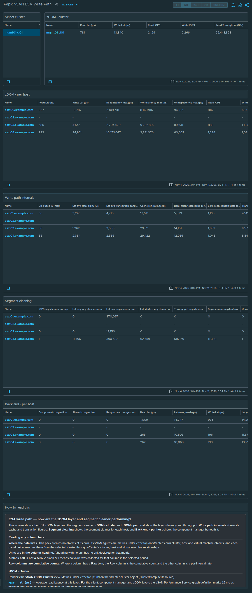

# Rapid vSAN ESA Write Path

## Widgets

- **Select cluster**: lists the clusters; the selected cluster drives every other widget.
- **zDOM - cluster**: the *vSAN zDOM Cluster* view, one row per cluster; 7 columns, including Read Lat (μs), Write Lat (μs), Read IOPS, Write IOPS, and more.
- **zDOM - per host**: the *vSAN zDOM Per Host* view, one row per host; 11 columns, including Read Lat (μs), Write Lat (μs), Read latency max (μs), Write latency max (μs), and more.
- **Write path internals**: the *vSAN zDOM Write Path* view, one row per host; 10 columns, including Disc used % (max), Lat avg total op IO (μs), Lat avg transaction bank (μs), Cache ref (rate, total), and more.
- **Segment cleaning**: the *vSAN Segment Cleaning Per Host* view, one row per host; 10 columns, including IOPS seg cleaner unmap, Lat avg seg cleaner unmap (μs), Lat max seg cleaner unmap (μs), Lat stddev seg cleaner unmap (μs), and more.
- **Back end - per host**: the *vSAN Host DOM Component Manager* view, one row per host; 16 columns, including Component congestion, Shared congestion, Resync read congestion, Read Lat (μs), and more.
- **How to read this**: the help text box, reproduced below.

## Help text

The text box on the dashboard reads as follows.

### ESA write path — how are the zDOM layer and segment cleaner performing?

This screen shows the ESA zDOM layer and the segment cleaner. **zDOM - cluster** and **zDOM - per host** show the layer's latency and throughput. **Write path internals** shows its cache and transaction figures. **Segment cleaning** shows the segment cleaner for each host, and **Back end - per host** shows the component manager beneath it.

#### Reading any column here

**Where the data lives.** This pack creates no objects of its own. Its vSAN figures are metrics under `cptvsan` on vCenter's own cluster, host and virtual machine objects, and each panel below reaches them from the selected cluster through vCenter's cluster, host and virtual machine relationships.

**Units are in the column heading.** A heading with no unit has no unit declared for that metric.

**A blank cell is not a zero.** A blank cell means no value was collected for that column in the selected period.

**Raw columns are cumulative counts.** Where a column has a Raw twin, the Raw column is the cumulative count and the other column is a per-interval rate.

#### zDOM - cluster

Renders the **vSAN zDOM Cluster** view. Metrics under `cptvsan|zDOM` on the vCenter cluster object (ClusterComputeResource).

**`Read Lat (μs)`** — Average read latency at this layer. For the client, component manager and zDOM layers the vSAN Performance Service graph definition marks 15 ms as warning and 30 ms as critical; it defines no threshold for the owner layer.

**`Write Lat (μs)`** — Average write latency at this layer. For the client, component manager and zDOM layers the vSAN Performance Service graph definition marks 15 ms as warning and 30 ms as critical; it defines no threshold for the owner layer.

**`Read IOPS`** — Read operations per second.

**`Write IOPS`** — Write operations per second.

**`Read Throughput (B/s)`** — Bytes per second read at this layer.

**`Write Throughput (B/s)`** — Bytes per second written at this layer.

**`OIO`** — Outstanding IO: operations issued and not yet completed. Latency multiplied by nothing tells you why it is high -- this does. High latency with high outstanding IO is queueing, high latency with low outstanding IO is a slow device.

#### zDOM - per host

Renders the **vSAN zDOM Per Host** view. Metrics under `cptvsan|zDOM` on the vCenter host object (HostSystem).

**`Read Lat (μs)`** — Average read latency at this layer. For the client, component manager and zDOM layers the vSAN Performance Service graph definition marks 15 ms as warning and 30 ms as critical; it defines no threshold for the owner layer.

**`Write Lat (μs)`** — Average write latency at this layer. For the client, component manager and zDOM layers the vSAN Performance Service graph definition marks 15 ms as warning and 30 ms as critical; it defines no threshold for the owner layer.

**`Read latency max (μs)`** — Worst read latency recorded in the zDOM layer, in microseconds.

**`Write latency max (μs)`** — Worst write latency recorded in the zDOM layer, in microseconds.

**`Unmap latency max (μs)`** — Worst unmap latency recorded in the zDOM layer, in microseconds.

**`Read IOPS`** — Read operations per second.

**`Write IOPS`** — Write operations per second.

**`Read Throughput (B/s)`** — Bytes per second read at this layer.

**`Write Throughput (B/s)`** — Bytes per second written at this layer.

**`OIO`** — Outstanding IO: operations issued and not yet completed. Latency multiplied by nothing tells you why it is high -- this does. High latency with high outstanding IO is queueing, high latency with low outstanding IO is a slow device.

**`OIO (write)`** — Outstanding write operations.

#### Write path internals

Renders the **vSAN zDOM Write Path** view. Metrics under `cptvsan|zDOM` on the vCenter host object (HostSystem).

**`Disc used % (max)`** — Highest disc used percentage in the interval.

**`Lat avg total op IO (μs)`** — Average latency of all zDOM operations.

**`Lat avg transaction bank (μs)`** — Average latency of transaction bank operations.

**`Cache ref (rate, total)`** — Rate of zDOM cache references, all kinds together.

**`Bank flush total cache ref (rate)`** — Cache references from flushing the transaction bank.

**`Seg clean context data total cache ref (rate)`** — Cache references from segment cleaning.

**`Transaction prefetch total cache ref (rate)`** — Cache references from transaction prefetch.

**`Transaction lookup cache ref (rate)`** — Cache references from transaction lookups.

**`Transaction (read, write, rate)`** — Read-write transaction rate in the zDOM layer.

**`Checkpoint worker wakeup ms`** — Interval, in milliseconds, at which the checkpoint worker wakes.

#### Segment cleaning

Renders the **vSAN Segment Cleaning Per Host** view. Metrics under `cptvsan|Storage I/O:dom-owner` on the vCenter host object (HostSystem).

**`IOPS seg cleaner unmap`** — Operations per second performed by the segment cleaner.

**`Lat avg seg cleaner unmap (μs)`** — Average segment cleaner unmap latency.

**`Lat max seg cleaner unmap (μs)`** — Worst segment cleaner unmap latency in the interval.

**`Lat stddev seg cleaner unmap (μs)`** — Standard deviation of segment cleaner unmap latency.

**`Throughput seg cleaner unmap (B/s)`** — Bytes per second moved by the segment cleaner.

**`Seg clean unmap leaf owner max lat (μs)`** — Segment cleaner unmap leaf-owner latency: the maximum of the averages, in microseconds.

**`Unmap IOPS`** — Space-reclamation operations per second, including those originated by guests trimming their filesystems.

**`Unmap Lat (μs)`** — Average latency of unmap operations.

**`Lat max unmap (μs)`** — Worst unmap latency in the interval.

**`Unmap count`** — Cumulative count of unmap operations.

#### Back end - per host

Renders the **vSAN Host DOM Component Manager** view. Metrics under `cptvsan|Storage I/O:dom-compmgr` on the vCenter host object (HostSystem).

**`Component congestion`** — Congestion raised against a single component. Shown beside shared congestion on the same row.

**`Shared congestion`** — Shared congestion, as distinct from congestion raised against a single component.

**`Resync read congestion`** — Congestion attributed to resync reads.

**`Read Lat (μs)`** — Average read latency at this layer. For the client, component manager and zDOM layers the vSAN Performance Service graph definition marks 15 ms as warning and 30 ms as critical; it defines no threshold for the owner layer.

**`Lat (max, read) (μs)`** — Worst read latency in the interval.

**`Write Lat (μs)`** — Average write latency at this layer. For the client, component manager and zDOM layers the vSAN Performance Service graph definition marks 15 ms as warning and 30 ms as critical; it defines no threshold for the owner layer.

**`Lat (max, write) (μs)`** — Worst write latency in the interval.

**`Lat stddev (write) (μs)`** — Standard deviation of write latency.

**`Read IOPS`** — Read operations per second.

**`Write IOPS`** — Write operations per second.

**`OIO`** — Outstanding IO: operations issued and not yet completed. Latency multiplied by nothing tells you why it is high -- this does. High latency with high outstanding IO is queueing, high latency with low outstanding IO is a slow device.

**`Read Throughput (B/s)`** — Bytes per second read at this layer.

**`Write Throughput (B/s)`** — Bytes per second written at this layer.

**`VM disk queue depth (write)`** — Queue depth for virtual disk writes at the component manager.

**`VM disk dispatched cost (write) (B/s)`** — Cost of dispatched virtual disk writes, as reported by the component manager.

**`Namespace dispatched cost (write) (B/s)`** — Cost of dispatched writes to namespace objects, which hold VM configuration files, as reported by the component manager.

## Complete the install

1. Go to Administration → Integrations → **Accounts** tab → **ADD** → choose the **vSAN Host Metrics** tile.
2. Fill in **Add Account - vSAN Host Metrics**: **Name**; **vCenter Server**; **vCenter username**; **Credential** → **+** → **Credential name** and **vCenter password** → **OK**; **Verify vCenter certificate**; **Cloud Proxy / Group** (9.1.1) or **Collector / Group** (8.18). The vCenter port is under **Advanced Settings** (default 443).
3. Click **VALIDATE CONNECTION** and accept the vCenter certificate when prompted. Then click **ADD**.
4. **After installing or upgrading the pak:** Administration → Integrations → Accounts → expand **vSAN Host Metrics** → check the account's **Status**. If it isn't collecting, use ⋮ on the account row → **Start Collecting**.
5. **Requirements:** vCenter 8.0 U3 or later, or 9.0 or later; a vCenter account that can read vSAN performance data.

No policy or super-metric changes are needed.
