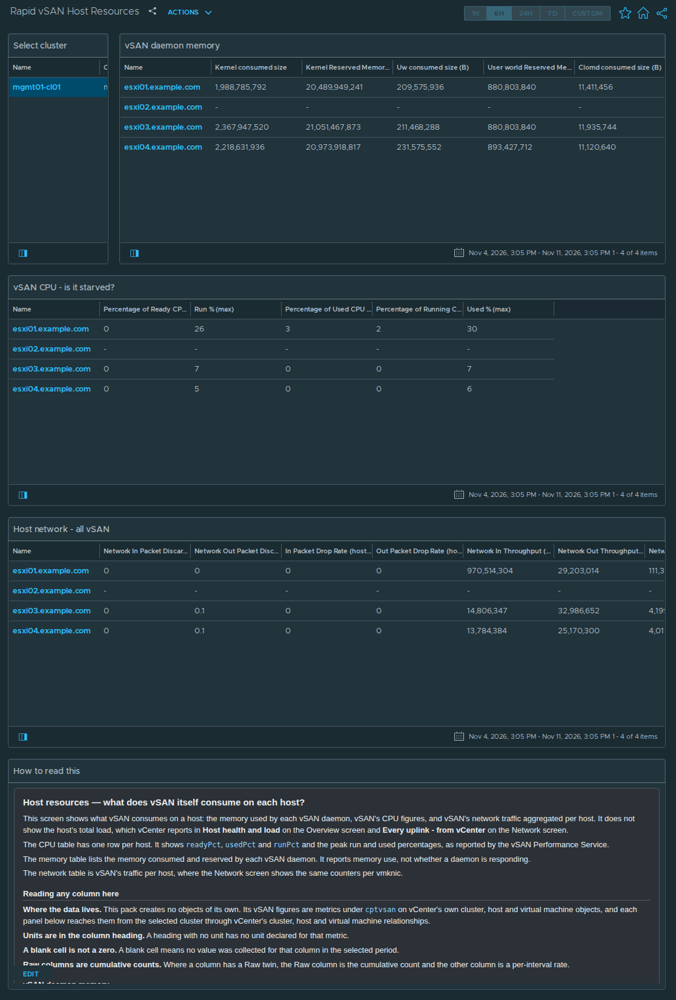

# Rapid vSAN Host Resources

## Widgets

- **Select cluster**: lists the clusters; the selected cluster drives every other widget.
- **vSAN daemon memory**: the *vSAN Host Memory* view, one row per host; 12 columns, including Kernel consumed size, Kernel Reserved Memory Size (B), Uw consumed size (B), User world Reserved Memory Size (B), and more.
- **vSAN CPU - is it starved?**: the *vSAN Host CPU* view, one row per host; 5 columns, including Percentage of Ready CPU Time (%), Run % (max), Percentage of Used CPU Time (%), Percentage of Running CPU Time (%), and more.
- **Host network - all vSAN**: the *vSAN Host Network* view, one row per host; 8 columns, including Network In Packet Discard Rate (%), Network Out Packet Discard Rate (%), In Packet Drop Rate (host port) (%), Out Packet Drop Rate (host port) (%), and more.
- **How to read this**: the help text box, reproduced below.

## Help text

The text box on the dashboard reads as follows.

### Host resources — what does vSAN itself consume on each host?

This screen shows what vSAN consumes on a host: the memory used by each vSAN daemon, vSAN's CPU figures, and vSAN's network traffic aggregated per host. It does not show the host's total load, which vCenter reports in **Host health and load** on the Overview screen and **Every uplink - from vCenter** on the Network screen.

The CPU table has one row per host. It shows `readyPct`, `usedPct` and `runPct` and the peak run and used percentages, as reported by the vSAN Performance Service.

The memory table lists the memory consumed and reserved by each vSAN daemon. It reports memory use, not whether a daemon is responding.

The network table is vSAN's traffic per host, where the Network screen shows the same counters per vmknic.

#### Reading any column here

**Where the data lives.** This pack creates no objects of its own. Its vSAN figures are metrics under `cptvsan` on vCenter's own cluster, host and virtual machine objects, and each panel below reaches them from the selected cluster through vCenter's cluster, host and virtual machine relationships.

**Units are in the column heading.** A heading with no unit has no unit declared for that metric.

**A blank cell is not a zero.** A blank cell means no value was collected for that column in the selected period.

**Raw columns are cumulative counts.** Where a column has a Raw twin, the Raw column is the cumulative count and the other column is a per-interval rate.

#### vSAN daemon memory

Renders the **vSAN Host Memory** view. Metrics under `cptvsan|Memory:vsan` on the vCenter host object (HostSystem).

**`Kernel consumed size`** — Memory in use by the vSAN kernel modules.

**`Kernel Reserved Memory Size (B)`** — Memory reserved for the vSAN kernel modules.

**`Uw consumed size (B)`** — Memory consumed by vSAN user-world processes in total.

**`User world Reserved Memory Size (B)`** — Memory reserved for vSAN user-world processes.

**`Clomd consumed size (B)`** — Memory used by clomd, the cluster level object manager daemon.

**`Clomd reserved size (B)`** — Memory reserved for clomd.

**`Cmmdsd consumed size (B)`** — Memory used by **cmmdsd**, the cluster directory service that maintains membership and object metadata.

**`Cmmdsd reserved size (B)`** — Memory reserved for cmmdsd.

**`Vsanmgmtd consumed size (B)`** — Memory used by vsanmgmtd, the vSAN management daemon.

**`Epd consumed size (B)`** — Memory used by epd, a vSAN daemon.

**`Osfsd consumed size (B)`** — Memory used by osfsd, the object filesystem daemon.

**`Vsandevicemonitord consumed size (B)`** — Memory used by vsandevicemonitord, the vSAN device monitor daemon.

#### vSAN CPU - is it starved?

Renders the **vSAN Host CPU** view. Metrics under `cptvsan|CPU:vsan` on the vCenter host object (HostSystem).

**`Percentage of Ready CPU Time (%)`** — Percentage of ready CPU time for vSAN's threads: time they were ready to run but had not been given a physical CPU. Reported by the vSAN Performance Service.

**`Run % (max)`** — Highest running-CPU percentage for vSAN in the interval.

**`Percentage of Used CPU Time (%)`** — Percentage of used CPU time for vSAN, as reported by the vSAN Performance Service.

**`Percentage of Running CPU Time (%)`** — Percentage of running CPU time for vSAN, as reported by the vSAN Performance Service.

**`Used % (max)`** — Highest used-CPU percentage for vSAN in the interval.

#### Host network - all vSAN

Renders the **vSAN Host Network** view. Metrics under `cptvsan|Network|Host` on the vCenter host object (HostSystem).

**`Network In Packet Discard Rate (%)`** — Proportion of inbound packets discarded at the host network layer, across all of this host's vSAN traffic rather than one uplink.

**`Network Out Packet Discard Rate (%)`** — Proportion of outbound packets discarded at the host network layer.

**`In Packet Drop Rate (host port) (%)`** — Inbound packets dropped by the vSwitch for this port.

**`Out Packet Drop Rate (host port) (%)`** — The vSwitch discarded outbound packets for this port.

**`Network In Throughput (B/s)`** — Inbound throughput for this host's vSAN traffic. Context for the error columns.

**`Network Out Throughput (B/s)`** — Outbound throughput for this host's vSAN traffic.

**`Network In Packets Per Second`** — Inbound packets per second.

**`Network Out Packets Per Second`** — Outbound packets per second.

## Complete the install

1. Go to Administration → Integrations → **Accounts** tab → **ADD** → choose the **vSAN Host Metrics** tile.
2. Fill in **Add Account - vSAN Host Metrics**: **Name**; **vCenter Server**; **vCenter username**; **Credential** → **+** → **Credential name** and **vCenter password** → **OK**; **Verify vCenter certificate**; **Cloud Proxy / Group** (9.1.1) or **Collector / Group** (8.18). The vCenter port is under **Advanced Settings** (default 443).
3. Click **VALIDATE CONNECTION** and accept the vCenter certificate when prompted. Then click **ADD**.
4. **After installing or upgrading the pak:** Administration → Integrations → Accounts → expand **vSAN Host Metrics** → check the account's **Status**. If it isn't collecting, use ⋮ on the account row → **Start Collecting**.
5. **Requirements:** vCenter 8.0 U3 or later, or 9.0 or later; a vCenter account that can read vSAN performance data.

No policy or super-metric changes are needed.
