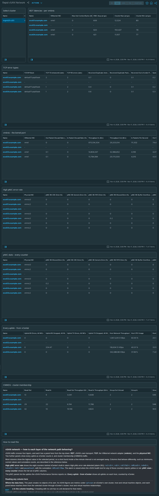

# Rapid vSAN Network

## Widgets

- **Select cluster**: lists the clusters; the selected cluster drives every other widget.
- **RDT latencies - per vmknic**: the *vSAN vmknic RDT Latency* view, one row per VMkernel NIC; 11 columns, including VMkernel NIC, Max Out Context Bytes (B), VNIC Avg Lat (μs), Cluster Max Lat (μs), and more.
- **TCP error types**: the *vSAN Host TCP Health* view, one row per host TCP/IP stack; 13 columns, including TCP/IP Stack, TCP TX retransmit (rate), TCP RX errors (rate), Received Duplicate Acknowledge Rate (%), and more.
- **vmknic - the kernel port**: the *vSAN vmknic* view, one row per VMkernel NIC; 11 columns, including VMkernel NIC, Out Packet Discard Rate (%), In Packet Discard Rate (%), Throughput In (B/s), and more.
- **High pNIC error rate**: the *vSAN High pNIC Error Rate* view, one row per physical NIC; 10 columns, including Physical NIC, pNIC RX CRC Error (%), pNIC RX Generic Error (%), pNIC RX FIFO Error (%), and more.
- **pNIC stats - every counter**: the *vSAN pNIC Errors* view, one row per physical NIC; 18 columns, including Physical NIC, pNIC RX Missed Error (%), pNIC RX CRC Error (%), pNIC RX Generic Error (%), and more.
- **Every uplink - from vCenter**: the *vSAN Host Uplinks and Load* view, one row per host; 13 columns, including Uplink RX Errors, All NICs, Uplink RX Dropped, All NICs, Uplink TX Errors, All NICs, Uplink TX Dropped, All NICs, and more.
- **CMMDS - cluster membership**: the *vSAN CMMDS Network* view, one row per host; 10 columns, including Read Out, Read In, Read Out Throughput (B/s), Read In Throughput (B/s), and more.
- **How to read this**: the help text box, reproduced below.

## Help text

The text box on the dashboard reads as follows.

### vSAN network — how is each layer of the network path behaving?

vSAN traffic crosses four layers, and each has a panel here from the top down: **RDT**, vSAN's own transport; **TCP**; the VMkernel network adapter (**vmknic**); and the **physical NIC**. Two further panels show every uplink as vCenter counts it, and cluster membership (CMMDS) traffic.

Most columns show the highest value in the selected period, so a short burst inside a five-minute interval is not averaged away. Columns that behave differently, such as minimums, current values and cumulative counts, are described in the reference below.

**High pNIC error rate** shows the eight counters behind vCenter's built-in alarm *High pNic error rate detected* (alarm-261): `rxCrcErr`, `rxErr`, `rxFifoErr`, `rxMissErr`, `rxOvErr`, `txCarErr`, `txErr` and `pauseCount`, with the cumulative `rxMissErrRaw`. The alarm is raised when the vSAN health test for any of those counters reports yellow or red. **pNIC stats - every counter** shows the full set of pNIC columns.

The pNIC panels list the uplinks the vSAN Performance Service reports on. **Every uplink - from vCenter** shows all uplinks on each host, counted by vCenter.

#### Reading any column here

**Where the data lives.** This pack creates no objects of its own. Its vSAN figures are metrics under `cptvsan` on vCenter's own cluster, host and virtual machine objects, and each panel below reaches them from the selected cluster through vCenter's cluster, host and virtual machine relationships.

**Units are in the column heading.** A heading with no unit has no unit declared for that metric.

**A blank cell is not a zero.** A blank cell means no value was collected for that column in the selected period.

**Raw columns are cumulative counts.** Where a column has a Raw twin, the Raw column is the cumulative count and the other column is a per-interval rate.

#### RDT latencies - per vmknic

Renders the **vSAN vmknic RDT Latency** view. Metrics under `cptvsan|Network|VMkernel NIC` on the vCenter host object (HostSystem), one row per vmkernel nic on each host.

**`Max Out Context Bytes (B)`** — Maximum outbound RDT context bytes over the last 5 seconds.

**`VNIC Avg Lat (μs)`** — Average round-trip latency of vSAN's own transport between hosts. This sits above TCP, so it can be slow while every NIC counter is clean.

**`Cluster Max Lat (μs)`** — Worst round-trip latency in the interval.

**`Cluster Min Lat (μs)`** — Best round-trip latency in the interval.

**`Avg Out Queueing Lat (μs)`** — Average time a message waited in the outbound queue before being sent. Queueing, as opposed to time on the wire.

**`Max Out Queueing Lat (μs)`** — Worst outbound queueing delay in the interval.

**`Socket Min Out Bytes (Low Is Bad) (B)`** — Lowest free space in the outbound socket buffer in the interval.

**`Socket Min In Bytes (Low Is Bad) (B)`** — Lowest free space seen in the inbound socket buffer. **Low is bad**, for the same reason.

**`Keepalive reset (Total)`** — Cumulative count of RDT keepalive resets.

**`Num ready delay (Total)`** — Cumulative count of ready delays.

#### TCP error types

Renders the **vSAN Host TCP Health** view. Metrics under `cptvsan|Network|TCP/IP Stack` on the vCenter host object (HostSystem), one row per tcp/ip stack on each host.

**`TCP TX retransmit (rate)`** — Segments this host retransmitted because they were not acknowledged.

**`TCP RX errors (rate)`** — Inbound TCP segments rejected as erroneous.

**`Received Duplicate Acknowledge Rate (%)`** — Duplicate acknowledgements received by this host.

**`Received Duplicate Packets Rate (%)`** — Duplicate packets received: data that arrived more than once.

**`Received Out-of-order Packets Rate (%)`** — Packets received out of order.

**`Sack Received Blocks Rate (%)`** — SACK (selective acknowledgement) blocks received.

**`Sack Send Blocks Rate (%)`** — SACK (selective acknowledgement) blocks sent.

**`Sack Rexmits Rate (%)`** — Segments retransmitted on the basis of SACK information.

**`Timeout Drop Rate (%)`** — Established connections dropped because the retransmission timer expired.

**`Half Open Drop Rate (%)`** — Half-open drop rate for the VMkernel network adapter.

**`TCP Send Zero Window (Total)`** — Times this host advertised a zero receive window to a peer.

**`TCP Errors (Total) (%)`** — Total TCP errors recorded by this host's stack since boot.

#### vmknic - the kernel port

Renders the **vSAN vmknic** view. Metrics under `cptvsan|Network|VMkernel NIC` on the vCenter host object (HostSystem), one row per vmkernel nic on each host.

**`Out Packet Discard Rate (%)`** — Proportion of outbound packets discarded at the host network layer.

**`In Packet Discard Rate (%)`** — Proportion of inbound packets discarded at the host network layer, across all of this host's vSAN traffic rather than one uplink.

**`Throughput In (B/s)`** — Inbound throughput for this host's vSAN traffic. Context for the error columns.

**`Throughput Out (B/s)`** — Outbound throughput for this host's vSAN traffic.

**`In Packets Per Second`** — Inbound packets per second.

**`Out Packets Per Second`** — Outbound packets per second.

**`Port RX packets`** — Packets received on this kernel port.

**`Port TX packets (Total)`** — Packets transmitted on this vSwitch port.

**`In Packet Drop Rate (vSwitch port) (%)`** — Inbound packets dropped by the vSwitch for this port.

**`Out Packet Drop Rate (vSwitch port) (%)`** — The vSwitch discarded outbound packets for this port.

#### High pNIC error rate

Renders the **vSAN High pNIC Error Rate** view. Metrics under `cptvsan|Network|Physical NIC` on the vCenter host object (HostSystem), one row per physical nic on each host.

**`pNIC RX CRC Error (%)`** — The frame arrived damaged and failed its checksum. One of the eight counters behind vCenter's built-in alarm *High pNic error rate detected* (alarm-261), which is raised when the vSAN health test for any of them reports yellow or red.

**`pNIC RX Generic Error (%)`** — Receive errors not attributed to a more specific counter. Useful as a catch-all; look to the specific counters first.

**`pNIC RX FIFO Error (%)`** — The NIC's own on-chip buffer overflowed before it could move packets across PCIe into host memory. The NIC could not hand data over fast enough.

**`pNIC RX Missed Error (%)`** — The NIC's receive ring had no free descriptor, so the packet was dropped before the driver saw it. Distinct from a drop (discarded higher up) and an error (arrived damaged). This table covers the uplinks the vSAN Performance Service reports on, which are the uplinks carrying vSAN traffic.

**`pNIC RX Buffer Overflow Error (%)`** — Receive buffer overflow errors on the physical NIC.

**`pNIC TX Carrier Error (%)`** — Carrier lost while transmitting.

**`pNIC TX Generic Error (%)`** — Transmit errors not attributed to a more specific counter.

**`pNic 802.3x Pause Rate (%)`** — 802.3x pause frames, the flow control a host and a switch use to ask each other to slow down. The counter has no direction: it does not separate pause frames received from pause frames sent. Pause frames are exchanged only when flow control is enabled on the uplink; an uplink's settings can be listed with `esxcli network nic pauseParams list`.

**`pNIC RX Missed Error (Total)`** — Cumulative count of missed receive errors. The column of the same name without Raw is the per-interval rate.

#### pNIC stats - every counter

Renders the **vSAN pNIC Errors** view. Metrics under `cptvsan|Network|Physical NIC` on the vCenter host object (HostSystem), one row per physical nic on each host.

**`pNIC RX Missed Error (%)`** — The NIC's receive ring had no free descriptor, so the packet was dropped before the driver saw it. Distinct from a drop (discarded higher up) and an error (arrived damaged). This table covers the uplinks the vSAN Performance Service reports on, which are the uplinks carrying vSAN traffic.

**`pNIC RX CRC Error (%)`** — The frame arrived damaged and failed its checksum. One of the eight counters behind vCenter's built-in alarm *High pNic error rate detected* (alarm-261), which is raised when the vSAN health test for any of them reports yellow or red.

**`pNIC RX Generic Error (%)`** — Receive errors not attributed to a more specific counter. Useful as a catch-all; look to the specific counters first.

**`pNIC RX FIFO Error (%)`** — The NIC's own on-chip buffer overflowed before it could move packets across PCIe into host memory. The NIC could not hand data over fast enough.

**`pNIC RX Buffer Overflow Error (%)`** — Receive buffer overflow errors on the physical NIC.

**`pNIC TX Carrier Error (%)`** — Carrier lost while transmitting.

**`pNIC TX Generic Error (%)`** — Transmit errors not attributed to a more specific counter.

**`In Packet Drop Rate (pNIC port) (%)`** — Inbound packets dropped by the vSwitch for this port.

**`Out Packet Drop Rate (pNIC port) (%)`** — The vSwitch discarded outbound packets for this port.

**`pNic 802.3x Pause Rate (%)`** — 802.3x pause frames, the flow control a host and a switch use to ask each other to slow down. The counter has no direction: it does not separate pause frames received from pause frames sent. Pause frames are exchanged only when flow control is enabled on the uplink; an uplink's settings can be listed with `esxcli network nic pauseParams list`.

**`IO chain drops`** — Packets dropped in the ESXi IO chain.

**`IO chain RX drops`** — Inbound packets dropped in the ESXi IO chain.

**`IO chain TX drops`** — Outbound packets dropped in the ESXi IO chain.

**`pNIC RX Missed Error (Total)`** — Cumulative count of missed receive errors. The column of the same name without Raw is the per-interval rate.

**`pNIC RX CRC Error (Total)`** — Cumulative count of CRC errors. The column of the same name without Raw is the per-interval rate.

**`pNIC PFC Count (Total)`** — Cumulative count of priority flow control frames.

**`Port TX packets (Total)`** — Packets transmitted on this vSwitch port.

#### Every uplink - from vCenter

Renders the **vSAN Host Uplinks and Load** view. vCenter's own metrics on each host, collected by the vCenter adapter.

**`Uplink RX Errors, All NICs`** — Inbound errors summed across every uplink on the host, counted by vCenter rather than by this pack.

**`Uplink RX Dropped, All NICs`** — Inbound packets dropped across every uplink on the host.

**`Uplink TX Errors, All NICs`** — Outbound errors across every uplink on the host.

**`Uplink TX Dropped, All NICs`** — Outbound packets dropped across every uplink on the host.

**`Host Network Throughput`** — Network throughput of the host, all uplinks and all traffic types, as reported by vCenter.

**`Host CPU Usage`** — CPU usage of the host, as reported by vCenter.

**`Host CPU Contention`** — CPU contention for the host: the proportion of time virtual machines waited for CPU, as reported by vCenter.

**`Host Memory Consumed`** — Proportion of host memory consumed.

**`Host Memory Swap-In Rate`** — Rate at which the host reads swapped memory back from disk, as reported by vCenter.

**`Host Uptime`** — Time since the host last booted.

**`Hardware Sensor Status`** — Overall hardware sensor health, as the host's own sensors report it.

**`Connectivity Issues, Critical`** — Count of critical connectivity findings against this host.

**`Utilisation Issues, Critical`** — Count of critical utilisation findings against this host.

#### CMMDS - cluster membership

Renders the **vSAN CMMDS Network** view. Metrics under `cptvsan|Network|Host` on the vCenter host object (HostSystem).

**`Read Out`** — Cluster directory messages sent by this host. CMMDS is how hosts agree on cluster membership and object placement; if it cannot talk, the cluster partitions, and that happens before any IO metric moves.

**`Read In`** — Cluster directory messages received.

**`Read Out Throughput (B/s)`** — CMMDS network read outbound throughput, in bytes per second.

**`Read In Throughput (B/s)`** — Bytes per second of inbound cluster directory traffic.

**`Group Out Unicast`** — Unicast membership messages sent.

**`Group In`** — Membership messages received.

**`Group Out Unicast Throughput (B/s)`** — Bytes per second of outbound unicast membership traffic.

**`Group In Throughput (B/s)`** — Bytes per second of inbound membership traffic.

**`Group Out Multicast`** — Multicast membership messages sent.

**`Group Out Multicast Throughput (B/s)`** — Bytes per second of outbound multicast membership traffic. Expected to be zero.
