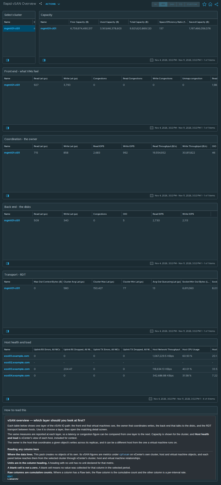

# Rapid vSAN Overview

## Widgets

- **Select cluster**: lists the clusters; the selected cluster drives every other widget.
- **Capacity**: the *vSAN Cluster Capacity* view, one row per cluster; 5 columns, including Free Capacity (B), Used Capacity (B), Total Capacity (B), Space Efficiency Ratio (100 = 1.00x), and more.
- **Front end - what VMs feel**: the *vSAN Cluster DOM Client* view, one row per cluster; 11 columns, including Read Lat (μs), Write Lat (μs), Congestions, Read Congestions, and more.
- **Coordination - the owner**: the *vSAN Cluster DOM Owner* view, one row per cluster; 10 columns, including Read Lat (μs), Write Lat (μs), Read IOPS, Write IOPS, and more.
- **Back end - the disks**: the *vSAN Cluster DOM Component Manager* view, one row per cluster; 6 columns, including Read Lat (μs), Write Lat (μs), Congestions, OIO, and more.
- **Transport - RDT**: the *vSAN Cluster RDT* view, one row per cluster; 9 columns, including Max Out Context Bytes (B), Cluster Avg Lat (μs), Cluster Max Lat (μs), Cluster Min Lat (μs), and more.
- **Host health and load**: the *vSAN Host Uplinks and Load* view, one row per host; 13 columns, including Uplink RX Errors, All NICs, Uplink RX Dropped, All NICs, Uplink TX Errors, All NICs, Uplink TX Dropped, All NICs, and more.
- **How to read this**: the help text box, reproduced below.

## Help text

The text box on the dashboard reads as follows.

### vSAN overview — which layer should you look at first?

Each table below shows one layer of the vSAN IO path: the front end that virtual machines see, the owner that coordinates writes, the back end that talks to the disks, and the RDT transport between hosts. Use it to choose a layer, then open the matching detail screen.

The same measures are reported at each layer, so a latency or congestion figure can be compared from one layer to the next. Capacity is shown for the cluster, and **Host health and load** is vCenter's view of each host, included for context.

The owner is the host that coordinates a given object's writes across its replicas, and it can be a different host from the one a virtual machine runs on.

#### Reading any column here

**Where the data lives.** This pack creates no objects of its own. Its vSAN figures are metrics under `cptvsan` on vCenter's own cluster, host and virtual machine objects, and each panel below reaches them from the selected cluster through vCenter's cluster, host and virtual machine relationships.

**Units are in the column heading.** A heading with no unit has no unit declared for that metric.

**A blank cell is not a zero.** A blank cell means no value was collected for that column in the selected period.

**Raw columns are cumulative counts.** Where a column has a Raw twin, the Raw column is the cumulative count and the other column is a per-interval rate.

#### Capacity

Renders the **vSAN Cluster Capacity** view. Metrics under `cptvsan|Capacity` on the vCenter cluster object (ClusterComputeResource).

**`Free Capacity (B)`** — Unused vSAN capacity.

**`Used Capacity (B)`** — Consumed vSAN capacity, after deduplication and compression.

**`Total Capacity (B)`** — Usable vSAN capacity. Already excludes the overhead vSAN reserves for itself, so it is smaller than the sum of the disks.

**`Space Efficiency Ratio (100 = 1.00x)`** — Space saving from deduplication and compression, expressed as a ratio scaled by 100: 134 means 1.34 to 1.

**`Saved Capacity (B)`** — Space saved by deduplication and compression, in bytes.

#### Front end - what VMs feel

Renders the **vSAN Cluster DOM Client** view. Metrics under `cptvsan|Storage I/O:dom-client` on the vCenter cluster object (ClusterComputeResource).

**`Read Lat (μs)`** — Average read latency at this layer. For the client, component manager and zDOM layers the vSAN Performance Service graph definition marks 15 ms as warning and 30 ms as critical; it defines no threshold for the owner layer.

**`Write Lat (μs)`** — Average write latency at this layer. For the client, component manager and zDOM layers the vSAN Performance Service graph definition marks 15 ms as warning and 30 ms as critical; it defines no threshold for the owner layer.

**`Congestions`** — vSAN congestion raised at this layer.

**`Read Congestions`** — Backpressure attributed to reads.

**`Write Congestions`** — Backpressure attributed to writes.

**`Unmap congestion`** — Congestion attributed to unmap operations.

**`Read IOPS`** — Read operations per second.

**`Write IOPS`** — Write operations per second.

**`OIO`** — Outstanding IO: operations issued and not yet completed. Latency multiplied by nothing tells you why it is high -- this does. High latency with high outstanding IO is queueing, high latency with low outstanding IO is a slow device.

**`Read Throughput (B/s)`** — Bytes per second read at this layer.

**`Write Throughput (B/s)`** — Bytes per second written at this layer.

#### Coordination - the owner

Renders the **vSAN Cluster DOM Owner** view. Metrics under `cptvsan|Storage I/O:dom-owner` on the vCenter cluster object (ClusterComputeResource).

**`Read Lat (μs)`** — Average read latency at this layer. For the client, component manager and zDOM layers the vSAN Performance Service graph definition marks 15 ms as warning and 30 ms as critical; it defines no threshold for the owner layer.

**`Write Lat (μs)`** — Average write latency at this layer. For the client, component manager and zDOM layers the vSAN Performance Service graph definition marks 15 ms as warning and 30 ms as critical; it defines no threshold for the owner layer.

**`Read IOPS`** — Read operations per second.

**`Write IOPS`** — Write operations per second.

**`Read Throughput (B/s)`** — Bytes per second read. The owner layer names its throughput columns differently from the client layer; the quantity is the same.

**`Write Throughput (B/s)`** — Bytes per second written.

**`OIO`** — Outstanding IO: operations issued and not yet completed. Latency multiplied by nothing tells you why it is high -- this does. High latency with high outstanding IO is queueing, high latency with low outstanding IO is a slow device.

**`Congestions`** — vSAN congestion raised at this layer.

**`Read Congestions`** — Backpressure attributed to reads.

**`Write Congestions`** — Backpressure attributed to writes.

#### Back end - the disks

Renders the **vSAN Cluster DOM Component Manager** view. Metrics under `cptvsan|Storage I/O:dom-compmgr` on the vCenter cluster object (ClusterComputeResource).

**`Read Lat (μs)`** — Average read latency at this layer. For the client, component manager and zDOM layers the vSAN Performance Service graph definition marks 15 ms as warning and 30 ms as critical; it defines no threshold for the owner layer.

**`Write Lat (μs)`** — Average write latency at this layer. For the client, component manager and zDOM layers the vSAN Performance Service graph definition marks 15 ms as warning and 30 ms as critical; it defines no threshold for the owner layer.

**`Congestions`** — vSAN congestion raised at this layer.

**`OIO`** — Outstanding IO: operations issued and not yet completed. Latency multiplied by nothing tells you why it is high -- this does. High latency with high outstanding IO is queueing, high latency with low outstanding IO is a slow device.

**`Read IOPS`** — Read operations per second.

**`Write IOPS`** — Write operations per second.

#### Transport - RDT

Renders the **vSAN Cluster RDT** view. Metrics under `cptvsan|Network|RDT` on the vCenter cluster object (ClusterComputeResource).

**`Max Out Context Bytes (B)`** — Maximum outbound RDT context bytes over the last 5 seconds.

**`Cluster Avg Lat (μs)`** — Average round-trip latency of vSAN's own transport between hosts. This sits above TCP, so it can be slow while every NIC counter is clean.

**`Cluster Max Lat (μs)`** — Worst round-trip latency in the interval.

**`Cluster Min Lat (μs)`** — Best round-trip latency in the interval.

**`Avg Out Queueing Lat (μs)`** — Average time a message waited in the outbound queue before being sent. Queueing, as opposed to time on the wire.

**`Socket Min Out Bytes (Low Is Bad) (B)`** — Lowest free space in the outbound socket buffer in the interval.

**`Socket Min In Bytes (Low Is Bad) (B)`** — Lowest free space seen in the inbound socket buffer. **Low is bad**, for the same reason.

**`Keepalive reset (Total)`** — Cumulative count of RDT keepalive resets.

**`Num ready delay (Total)`** — Cumulative count of ready delays.

#### Host health and load

Renders the **vSAN Host Uplinks and Load** view. vCenter's own metrics on each host, collected by the vCenter adapter.

**`Uplink RX Errors, All NICs`** — Inbound errors summed across every uplink on the host, counted by vCenter rather than by this pack.

**`Uplink RX Dropped, All NICs`** — Inbound packets dropped across every uplink on the host.

**`Uplink TX Errors, All NICs`** — Outbound errors across every uplink on the host.

**`Uplink TX Dropped, All NICs`** — Outbound packets dropped across every uplink on the host.

**`Host Network Throughput`** — Network throughput of the host, all uplinks and all traffic types, as reported by vCenter.

**`Host CPU Usage`** — CPU usage of the host, as reported by vCenter.

**`Host CPU Contention`** — CPU contention for the host: the proportion of time virtual machines waited for CPU, as reported by vCenter.

**`Host Memory Consumed`** — Proportion of host memory consumed.

**`Host Memory Swap-In Rate`** — Rate at which the host reads swapped memory back from disk, as reported by vCenter.

**`Host Uptime`** — Time since the host last booted.

**`Hardware Sensor Status`** — Overall hardware sensor health, as the host's own sensors report it.

**`Connectivity Issues, Critical`** — Count of critical connectivity findings against this host.

**`Utilisation Issues, Critical`** — Count of critical utilisation findings against this host.

## Complete the install

1. Go to Administration → Integrations → **Accounts** tab → **ADD** → choose the **vSAN Host Metrics** tile.
2. Fill in **Add Account - vSAN Host Metrics**: **Name**; **vCenter Server**; **vCenter username**; **Credential** → **+** → **Credential name** and **vCenter password** → **OK**; **Verify vCenter certificate**; **Cloud Proxy / Group** (9.1.1) or **Collector / Group** (8.18). The vCenter port is under **Advanced Settings** (default 443).
3. Click **VALIDATE CONNECTION** and accept the vCenter certificate when prompted. Then click **ADD**.
4. **After installing or upgrading the pak:** Administration → Integrations → Accounts → expand **vSAN Host Metrics** → check the account's **Status**. If it isn't collecting, use ⋮ on the account row → **Start Collecting**.
5. **Requirements:** vCenter 8.0 U3 or later, or 9.0 or later; a vCenter account that can read vSAN performance data.

No policy or super-metric changes are needed.
