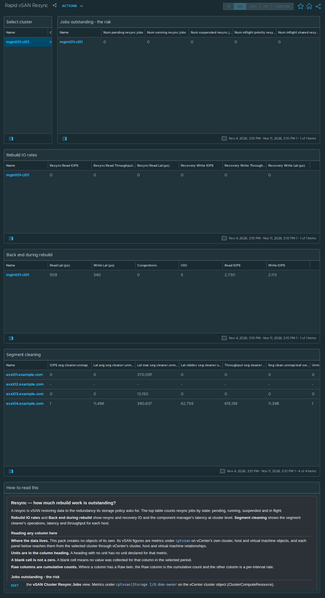
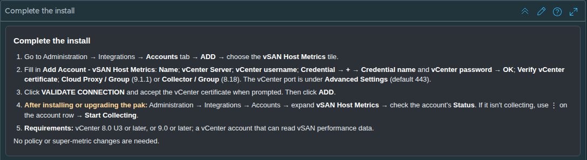

# Rapid vSAN Resync

## Widgets

- **Select cluster**: lists the clusters; the selected cluster drives every other widget.
- **Jobs outstanding - the risk**: the *vSAN Cluster Resync Jobs* view, one row per cluster; 14 columns, including Num pending resync jobs, Num running resync jobs, Num suspended resync jobs, Num inflight priority resync jobs, and more.
- **Rebuild IO rates**: the *vSAN Cluster Resync* view, one row per cluster; 6 columns, including Resync Read IOPS, Resync Read Throughput (B/s), Resync Read Lat (μs), Recovery Write IOPS, and more.
- **Back end during rebuild**: the *vSAN Cluster DOM Component Manager* view, one row per cluster; 6 columns, including Read Lat (μs), Write Lat (μs), Congestions, OIO, and more.
- **Segment cleaning**: the *vSAN Segment Cleaning Per Host* view, one row per host; 10 columns, including IOPS seg cleaner unmap, Lat avg seg cleaner unmap (μs), Lat max seg cleaner unmap (μs), Lat stddev seg cleaner unmap (μs), and more.
- **How to read this**: the help text box, reproduced below.

## Help text

The text box on the dashboard reads as follows.

### Resync — how much rebuild work is outstanding?

A resync is vSAN restoring data to the redundancy its storage policy asks for. The top table counts resync jobs by state: pending, running, suspended and in flight.

**Rebuild IO rates** and **Back end during rebuild** show resync and recovery IO and the component manager's latency at cluster level. **Segment cleaning** shows the segment cleaner's operations, latency and throughput for each host.

#### Reading any column here

**Where the data lives.** This pack creates no objects of its own. Its vSAN figures are metrics under `cptvsan` on vCenter's own cluster, host and virtual machine objects, and each panel below reaches them from the selected cluster through vCenter's cluster, host and virtual machine relationships.

**Units are in the column heading.** A heading with no unit has no unit declared for that metric.

**A blank cell is not a zero.** A blank cell means no value was collected for that column in the selected period.

**Raw columns are cumulative counts.** Where a column has a Raw twin, the Raw column is the cumulative count and the other column is a per-interval rate.

#### Jobs outstanding - the risk

Renders the **vSAN Cluster Resync Jobs** view. Metrics under `cptvsan|Storage I/O:dom-owner` on the vCenter cluster object (ClusterComputeResource).

**`Num pending resync jobs`** — Resync jobs queued and not yet started.

**`Num running resync jobs`** — Resync jobs currently running.

**`Num suspended resync jobs`** — Resync jobs currently suspended.

**`Num inflight priority resync jobs`** — Priority resync jobs in flight.

**`Num inflight shared resync jobs`** — Shared resync jobs in flight.

**`Num pending decom resync jobs`** — Pending resync jobs created by decommissioning.

**`Num pending full resync jobs`** — Pending full resync jobs.

**`Num running full resync jobs`** — Running full resync jobs.

**`Resync parallelism (average)`** — Average number of resync operations running in parallel.

**`Num complete resync ops`** — Cumulative count of completed resync operations.

**`Num complete full resync ops`** — Cumulative count of completed full resync operations.

**`Resync Read IOPS`** — Read operations per second performed to rebuild redundancy. **Zero unless something is actually resyncing**, which is the normal and desirable reading.

**`Recovery Write IOPS`** — Write operations per second performed to restore redundancy -- the other half of a rebuild.

**`Write IOPS`** — Write operations per second.

#### Rebuild IO rates

Renders the **vSAN Cluster Resync** view. Metrics under `cptvsan|Storage I/O:dom-compmgr` on the vCenter cluster object (ClusterComputeResource).

**`Resync Read IOPS`** — Read operations per second performed to rebuild redundancy. **Zero unless something is actually resyncing**, which is the normal and desirable reading.

**`Resync Read Throughput (B/s)`** — Bytes per second read for rebuild.

**`Resync Read Lat (μs)`** — Average latency of rebuild reads.

**`Recovery Write IOPS`** — Write operations per second performed to restore redundancy -- the other half of a rebuild.

**`Recovery Write Throughput (B/s)`** — Bytes per second written to restore redundancy. Divide the outstanding work by this to estimate how long a rebuild has left.

**`Recovery Write Lat (μs)`** — Average latency of recovery writes.

#### Back end during rebuild

Renders the **vSAN Cluster DOM Component Manager** view. Metrics under `cptvsan|Storage I/O:dom-compmgr` on the vCenter cluster object (ClusterComputeResource).

**`Read Lat (μs)`** — Average read latency at this layer. For the client, component manager and zDOM layers the vSAN Performance Service graph definition marks 15 ms as warning and 30 ms as critical; it defines no threshold for the owner layer.

**`Write Lat (μs)`** — Average write latency at this layer. For the client, component manager and zDOM layers the vSAN Performance Service graph definition marks 15 ms as warning and 30 ms as critical; it defines no threshold for the owner layer.

**`Congestions`** — vSAN congestion raised at this layer.

**`OIO`** — Outstanding IO: operations issued and not yet completed. Latency multiplied by nothing tells you why it is high -- this does. High latency with high outstanding IO is queueing, high latency with low outstanding IO is a slow device.

**`Read IOPS`** — Read operations per second.

**`Write IOPS`** — Write operations per second.

#### Segment cleaning

Renders the **vSAN Segment Cleaning Per Host** view. Metrics under `cptvsan|Storage I/O:dom-owner` on the vCenter host object (HostSystem).

**`IOPS seg cleaner unmap`** — Operations per second performed by the segment cleaner.

**`Lat avg seg cleaner unmap (μs)`** — Average segment cleaner unmap latency.

**`Lat max seg cleaner unmap (μs)`** — Worst segment cleaner unmap latency in the interval.

**`Lat stddev seg cleaner unmap (μs)`** — Standard deviation of segment cleaner unmap latency.

**`Throughput seg cleaner unmap (B/s)`** — Bytes per second moved by the segment cleaner.

**`Seg clean unmap leaf owner max lat (μs)`** — Segment cleaner unmap leaf-owner latency: the maximum of the averages, in microseconds.

**`Unmap IOPS`** — Space-reclamation operations per second, including those originated by guests trimming their filesystems.

**`Unmap Lat (μs)`** — Average latency of unmap operations.

**`Lat max unmap (μs)`** — Worst unmap latency in the interval.

**`Unmap count`** — Cumulative count of unmap operations.

## Complete the install

1. Go to Administration → Integrations → **Accounts** tab → **ADD** → choose the **vSAN Host Metrics** tile.
2. Fill in **Add Account - vSAN Host Metrics**: **Name**; **vCenter Server**; **vCenter username**; **Credential** → **+** → **Credential name** and **vCenter password** → **OK**; **Verify vCenter certificate**; **Cloud Proxy / Group** (9.1.1) or **Collector / Group** (8.18). The vCenter port is under **Advanced Settings** (default 443).
3. Click **VALIDATE CONNECTION** and accept the vCenter certificate when prompted. Then click **ADD**.
4. **After installing or upgrading the pak:** Administration → Integrations → Accounts → expand **vSAN Host Metrics** → check the account's **Status**. If it isn't collecting, use ⋮ on the account row → **Start Collecting**.
5. **Requirements:** vCenter 8.0 U3 or later, or 9.0 or later; a vCenter account that can read vSAN performance data.

No policy or super-metric changes are needed.
