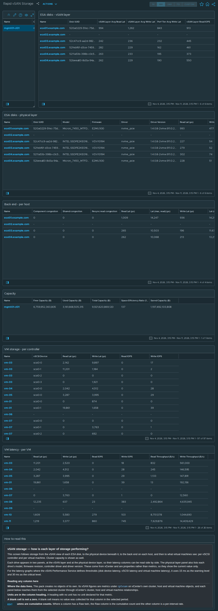

# Rapid vSAN Storage

## Widgets

- **Select cluster**: lists the clusters; the selected cluster drives every other widget.
- **ESA disks - vSAN layer**: the *vSAN ESA Disks* view, one row per ESA disk; 6 columns, including Disk UUID, vSAN Layer Avg Read Lat, vSAN Layer Avg Write Lat, Perf Tier Avg Write Lat, and more.
- **ESA disks - physical layer**: the *vSAN ESA Disk Physical Layer* view, one row per ESA disk; 10 columns, including Disk UUID, Model, Firmware, Driver, and more.
- **Back end - per host**: the *vSAN Host DOM Component Manager* view, one row per host; 16 columns, including Component congestion, Shared congestion, Resync read congestion, Read Lat (μs), and more.
- **Capacity**: the *vSAN Cluster Capacity* view, one row per cluster; 5 columns, including Free Capacity (B), Used Capacity (B), Total Capacity (B), Space Efficiency Ratio (100 = 1.00x), and more.
- **VM storage - per controller**: the *vSAN VM Storage* view, one row per VM vSCSI controller; 5 columns, including vSCSI Device, Read Lat (μs), Write Lat (μs), Read IOPS, and more.
- **VM latency - per VM**: the *vSAN VM Latency* view, one row per virtual machine; 6 columns, including Read Lat (μs), Write Lat (μs), Read IOPS, Write IOPS, and more.
- **How to read this**: the help text box, reproduced below.

## Help text

The text box on the dashboard reads as follows.

### vSAN storage — how is each layer of storage performing?

This screen follows storage from the vSAN view of each ESA disk, to the physical device beneath it, to the back end on each host, and then to what virtual machines see: per vSCSI controller and per virtual machine. Cluster capacity is shown as well.

Each drive appears in two panels, at the vSAN layer and at the physical device layer, so their latency columns can be read side by side. The physical layer panel also lists each drive's model, firmware revision, controller driver and driver version. These come from vCenter and are properties rather than metrics, so they show the current value only.

For the latency graphs where the vSAN Performance Service defines thresholds (disk device latency, vSCSI latency and virtual machine latency), it uses 15 ms as the warning level and 30 ms as the critical level.

#### Reading any column here

**Where the data lives.** This pack creates no objects of its own. Its vSAN figures are metrics under `cptvsan` on vCenter's own cluster, host and virtual machine objects, and each panel below reaches them from the selected cluster through vCenter's cluster, host and virtual machine relationships.

**Units are in the column heading.** A heading with no unit has no unit declared for that metric.

**A blank cell is not a zero.** A blank cell means no value was collected for that column in the selected period.

**Raw columns are cumulative counts.** Where a column has a Raw twin, the Raw column is the cumulative count and the other column is a per-interval rate.

#### ESA disks - vSAN layer

Renders the **vSAN ESA Disks** view. Metrics under `cptvsan|Disk` on the vCenter host object (HostSystem), one row per disk uuid on each host.

**`vSAN Layer Avg Read Lat`** — Read latency as vSAN sees it, above the device.

**`vSAN Layer Avg Write Lat`** — Write latency as vSAN sees it.

**`Perf Tier Avg Write Lat`** — Write latency at the performance tier.

**`vSAN Layer Read IOPS`** — Read operations per second at the vSAN layer. Context -- high latency at high IOPS is a busy disk, high latency at low IOPS is a sick one.

**`vSAN Layer Write IOPS`** — Write operations per second at the vSAN layer.

#### ESA disks - physical layer

Renders the **vSAN ESA Disk Physical Layer** view. Metrics under `cptvsan|Disk` on the vCenter host object (HostSystem), one row per disk uuid on each host.

**`Model`** — The drive's model string as the storage controller reports it.

**`Firmware`** — The drive's firmware revision, read from the device through vCenter. The vSAN Performance Service does not report firmware.

**`Driver`** — The ESXi driver module bound to the storage controller this drive sits behind. It belongs to the controller, so drives behind the same controller show the same driver. Blank when the host's storage topology could not be read; the drive's firmware is still reported.

**`Driver Version`** — The version string of the controller's driver, taken from the HCL section of the cluster health summary. Blank when that summary is unavailable; the driver name is still reported.

**`Read Lat (μs)`** — Read latency at the physical and firmware layer, below vSAN. The vSAN Performance Service graph definition marks 15 ms as warning and 30 ms as critical.

**`Write Lat (μs)`** — Write latency at the physical and firmware layer, below vSAN. The vSAN Performance Service graph definition marks 15 ms as warning and 30 ms as critical.

**`Device Avg Lat (μs)`** — **DAVG** -- time spent in the device itself. High DAVG is a slow or failing drive.

**`Kernel Avg Lat (μs)`** — KAVG: average time a command spends in the VMkernel.

**`Guest Avg Lat (μs)`** — GAVG: average latency seen by the guest, equal to DAVG plus KAVG.

#### Back end - per host

Renders the **vSAN Host DOM Component Manager** view. Metrics under `cptvsan|Storage I/O:dom-compmgr` on the vCenter host object (HostSystem).

**`Component congestion`** — Congestion raised against a single component. Shown beside shared congestion on the same row.

**`Shared congestion`** — Shared congestion, as distinct from congestion raised against a single component.

**`Resync read congestion`** — Congestion attributed to resync reads.

**`Read Lat (μs)`** — Average read latency at this layer. For the client, component manager and zDOM layers the vSAN Performance Service graph definition marks 15 ms as warning and 30 ms as critical; it defines no threshold for the owner layer.

**`Lat (max, read) (μs)`** — Worst read latency in the interval.

**`Write Lat (μs)`** — Average write latency at this layer. For the client, component manager and zDOM layers the vSAN Performance Service graph definition marks 15 ms as warning and 30 ms as critical; it defines no threshold for the owner layer.

**`Lat (max, write) (μs)`** — Worst write latency in the interval.

**`Lat stddev (write) (μs)`** — Standard deviation of write latency.

**`Read IOPS`** — Read operations per second.

**`Write IOPS`** — Write operations per second.

**`OIO`** — Outstanding IO: operations issued and not yet completed. Latency multiplied by nothing tells you why it is high -- this does. High latency with high outstanding IO is queueing, high latency with low outstanding IO is a slow device.

**`Read Throughput (B/s)`** — Bytes per second read at this layer.

**`Write Throughput (B/s)`** — Bytes per second written at this layer.

**`VM disk queue depth (write)`** — Queue depth for virtual disk writes at the component manager.

**`VM disk dispatched cost (write) (B/s)`** — Cost of dispatched virtual disk writes, as reported by the component manager.

**`Namespace dispatched cost (write) (B/s)`** — Cost of dispatched writes to namespace objects, which hold VM configuration files, as reported by the component manager.

#### Capacity

Renders the **vSAN Cluster Capacity** view. Metrics under `cptvsan|Capacity` on the vCenter cluster object (ClusterComputeResource).

**`Free Capacity (B)`** — Unused vSAN capacity.

**`Used Capacity (B)`** — Consumed vSAN capacity, after deduplication and compression.

**`Total Capacity (B)`** — Usable vSAN capacity. Already excludes the overhead vSAN reserves for itself, so it is smaller than the sum of the disks.

**`Space Efficiency Ratio (100 = 1.00x)`** — Space saving from deduplication and compression, expressed as a ratio scaled by 100: 134 means 1.34 to 1.

**`Saved Capacity (B)`** — Space saved by deduplication and compression, in bytes.

#### VM storage - per controller

Renders the **vSAN VM Storage** view. Metrics under `cptvsan|vSCSI` on the vCenter virtual machine object (VirtualMachine), one row per vscsi device on each virtual machine.

**`Read Lat (μs)`** — Read latency for this virtual disk, measured at the vSAN layer. The vSAN Performance Service graph definition marks 15 ms as warning and 30 ms as critical.

**`Write Lat (μs)`** — Write latency for this virtual disk, measured at the vSAN layer. The vSAN Performance Service graph definition marks 15 ms as warning and 30 ms as critical.

**`Read IOPS`** — Read operations per second.

**`Write IOPS`** — Write operations per second.

#### VM latency - per VM

Renders the **vSAN VM Latency** view. Metrics under `cptvsan|VM:local` on the vCenter virtual machine object (VirtualMachine).

**`Read Lat (μs)`** — Read latency for this virtual disk, measured at the vSAN layer. The vSAN Performance Service graph definition marks 15 ms as warning and 30 ms as critical.

**`Write Lat (μs)`** — Write latency for this virtual disk, measured at the vSAN layer. The vSAN Performance Service graph definition marks 15 ms as warning and 30 ms as critical.

**`Read IOPS`** — Read operations per second.

**`Write IOPS`** — Write operations per second.

**`Read Throughput (B/s)`** — Bytes per second read at this layer.

**`Write Throughput (B/s)`** — Bytes per second written at this layer.

## Complete the install

1. Go to Administration → Integrations → **Accounts** tab → **ADD** → choose the **vSAN Host Metrics** tile.
2. Fill in **Add Account - vSAN Host Metrics**: **Name**; **vCenter Server**; **vCenter username**; **Credential** → **+** → **Credential name** and **vCenter password** → **OK**; **Verify vCenter certificate**; **Cloud Proxy / Group** (9.1.1) or **Collector / Group** (8.18). The vCenter port is under **Advanced Settings** (default 443).
3. Click **VALIDATE CONNECTION** and accept the vCenter certificate when prompted. Then click **ADD**.
4. **After installing or upgrading the pak:** Administration → Integrations → Accounts → expand **vSAN Host Metrics** → check the account's **Status**. If it isn't collecting, use ⋮ on the account row → **Start Collecting**.
5. **Requirements:** vCenter 8.0 U3 or later, or 9.0 or later; a vCenter account that can read vSAN performance data.

No policy or super-metric changes are needed.
