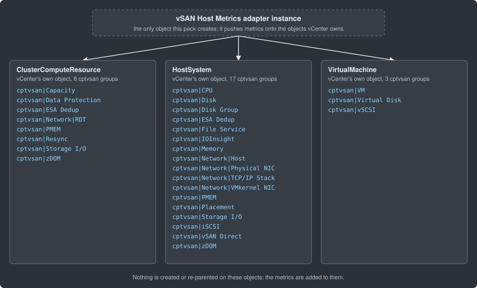

# Where the data lives: vSAN Host Metrics

> Generated by `tools/fix_generated_docs.py` after each build. Do not edit.

This pack creates **no resource kinds** and no inventory tree of its own. The only object it
creates is its adapter instance. Everything it collects (69 vSAN Performance Service entity
types) is pushed as `cptvsan|...` metrics and properties onto objects that vCenter's own adapter
already owns:

| vCenter object | Groups | `cptvsan` groups on it |
|---|---|---|
| `ClusterComputeResource` | 8 | `Capacity`, `Data Protection`, `ESA Dedup`, `Network|RDT`, `PMEM`, `Resync`, `Storage I/O`, `zDOM` |
| `HostSystem` | 17 | `CPU`, `Disk`, `Disk Group`, `ESA Dedup`, `File Service`, `IOInsight`, `Memory`, `Network|Host`, `Network|Physical NIC`, `Network|TCP/IP Stack`, `Network|VMkernel NIC`, `PMEM`, `Placement`, `Storage I/O`, `iSCSI`, `vSAN Direct`, `zDOM` |
| `VirtualMachine` | 3 | `VM`, `Virtual Disk`, `vSCSI` |

The pack does not create, move or re-parent any of these objects, and writes no relationships
(`ci/no_relationships.sh` enforces this). To find the data, open the vCenter cluster, host or
virtual machine in Operations and look under the `cptvsan` metric group. The views and
dashboards read it from the selected cluster through vCenter's own cluster, host and virtual
machine relationships.

The full list of metrics and properties is in [REFERENCE.md](../REFERENCE.md).
